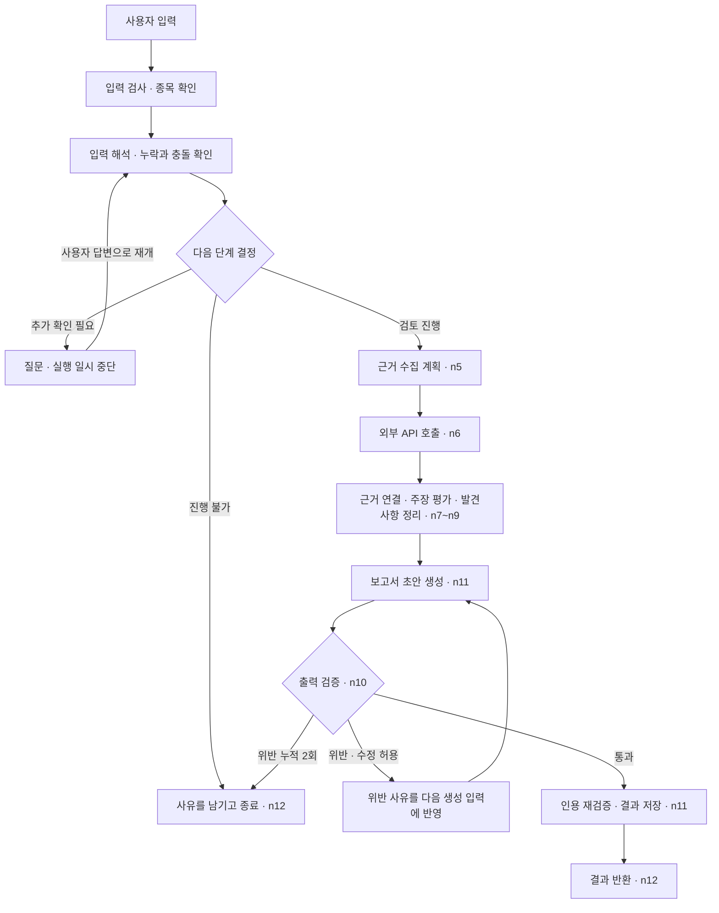
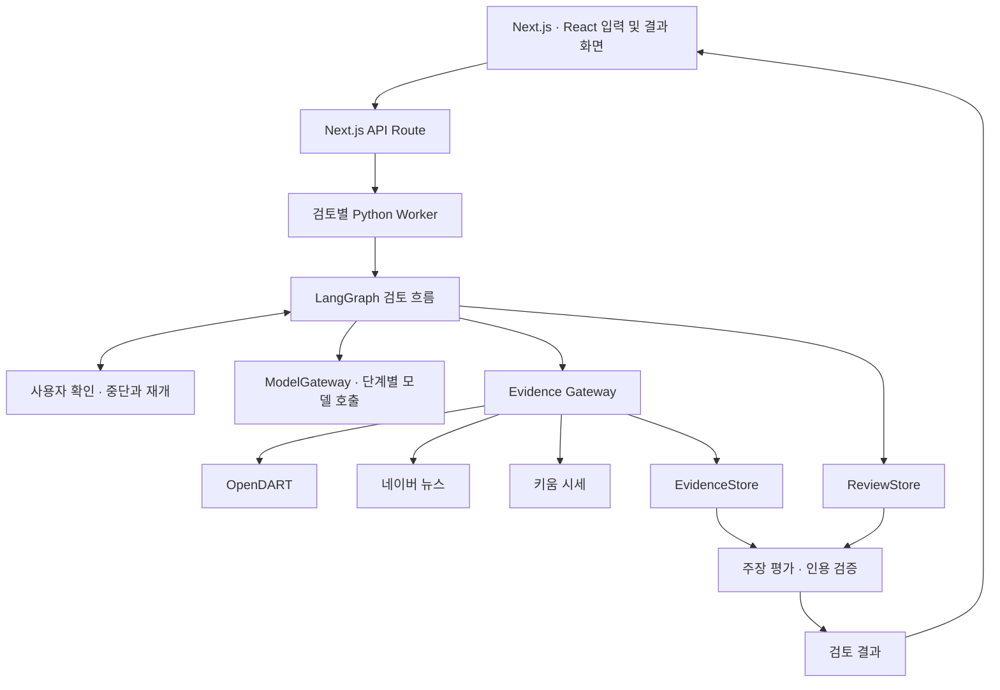

# Cognitive Bias Help AI

**내 투자 판단을 공시·뉴스·시세와 대조하고, 놓친 근거와 다시 확인할 질문을 정리하는 AI 서비스입니다.**

“실적이 좋아질 것 같아서 이 종목을 사려고 한다”는 생각에는 사실, 기대, 추측이 섞여 있습니다. 이 프로젝트는 그 판단을 검토 가능한 주장으로 나누고 외부 자료와 비교합니다. 사용자는 자신의 판단을 뒷받침하는 자료뿐 아니라 반대 근거와 확인하지 못한 정보도 함께 볼 수 있습니다.

현재는 **로컬 웹 UI와 Python 검토 런타임을 연결한 개발 단계**입니다. 매수·매도 주문이나 수익률 예측은 제공하지 않습니다.

팀 프로젝트로 진행했으며, 시세·종목, 공시·저장, 그래프·판단 영역을 나누어 개발했습니다. 아래에서는 각 영역을 연결한 검토 흐름과 주요 설계 결정을 설명합니다.

## 주요 기능

| 기능 | 동작 |
| --- | --- |
| 판단 입력 | 자유 입력, 항목별 입력, 두 방식을 합친 입력을 지원합니다. |
| 주장 추출 | 입력에서 검토할 주장을 분리하고, 사용자 답변과 모델 추론의 출처를 구분합니다. |
| 추가 확인 | 종목이 모호하거나 확인할 정보가 있으면 질문한 뒤 검토를 이어갑니다. |
| 외부 근거 수집 | OpenDART 공시·재무, 네이버 뉴스, 키움 시세 데이터를 공통 Gateway로 수집합니다. |
| 근거 대조 | 주장별 지지·반대·중립·판단 불가 근거와 수치 비교 결과를 정리합니다. |
| 결과 확인 | 주장에 직접 연결된 근거와 종목 참고 자료를 나눠 보여주고, 원문 링크와 수집 상태를 제공합니다. |

입력 화면은 판단 대상 → 판단의 근거 → 균형 확인 → 다시 볼 기준의 네 단계로 구성했습니다. “잘 모르겠어요”, “아직 정하지 못했어요”, “답변하지 않을게요”를 구분해, 서로 다른 응답을 단순한 빈칸으로 처리하지 않습니다.

## Agent의 실행 흐름

검토는 입력에서 보고서까지 진행하되, 중간 판단에 따라 사용자에게 다시 묻거나 보고서를 수정하는 루프를 포함합니다. 반복할 때는 이전 답변과 검증 피드백을 다음 입력에 반영합니다.



위 그림은 주요 정상 경로와 반복 경로를 요약한 것입니다. 입력·수집·평가 단계에서 차단 사유가 발생하면 종료 경로로 이동합니다.

### 사용자 확인 루프

`intake_review`는 입력을 해석한 뒤 누락·충돌·모호성을 확인합니다. 추가 확인이 필요하면 `interrupt`로 실행을 멈추고, 답변이 들어오면 저장된 질문 이력과 함께 다시 검토합니다. 상태에 따라 근거 수집으로 진행하거나 추가 질문 또는 종료를 선택합니다.

질문 대상은 정책 코드가 정합니다. 한 번에 최대 두 항목을 묻고, 이미 질문한 항목이나 사용자가 답변을 거절한 항목은 질문 대상에서 제외합니다. 모델의 해석과 실행 제어를 분리해 불필요한 재질문을 줄였습니다.

### 보고서 검증·수정 루프

`n11`이 만든 초안을 `n10`이 검증합니다. 위반이 발견되면 `guard_feedback`에 사유를 남기고 `n11`이 이를 반영해 다시 작성합니다. 검증을 통과한 후보만 인용을 재확인한 뒤 저장합니다.

현재 구현은 위반 판정이 누적 두 번이면 `budget_exceeded`로 종료합니다. 첫 초안이 위반되었을 때 한 번 수정할 수 있으며, 수정본도 위반되면 계속 생성하지 않습니다.

입력 의미 추출에도 별도의 보정 경로가 있습니다. 수정 가능한 의미 검증 오류는 오류 범주와 대상 정보를 다음 모델 입력에 전달하며, 호출은 최대 두 번으로 제한합니다.

현재 외부 근거 수집 경로는 `n5 → n6 → n7 → n8 → n9`로 진행합니다. 평가 결과를 보고 검색 계획으로 돌아가는 재검색 루프는 현재 그래프에 연결되어 있지 않습니다. Agent의 반복 동작은 사용자 확인, 의미 추출 보정, 보고서 검증·수정에서 구현되어 있습니다.

관련 코드: [그래프 분기](https://github.com/cognitive-bias-help-AI/cognitive-bias-help-AI/blob/main/app/orchestration/graph.py) · [노드 실행과 반복 제어](https://github.com/cognitive-bias-help-AI/cognitive-bias-help-AI/blob/main/app/orchestration/nodes/s0.py) · [보고서 후보와 피드백](https://github.com/cognitive-bias-help-AI/cognitive-bias-help-AI/blob/main/app/orchestration/reporting.py)

## 시스템 구성



웹 요청은 서버에서 Python Worker를 실행하고 JSON 메시지로 검토를 시작하거나 재개합니다. 검토 흐름, 모델 호출, 외부 API, 저장소는 각각 인터페이스로 분리했습니다. 로컬 실행에서는 메모리 저장소를 사용하며, 근거 수집 데이터에는 별도의 PostgreSQL 구현이 있습니다.

| 영역 | 기술 | 사용한 이유 |
| --- | --- | --- |
| 검토 흐름 | Python 3.12+, LangGraph | 단계별 상태와 분기를 명시하고 사용자 확인 후 실행을 이어가기 위해 사용했습니다. |
| 데이터 계약 | Pydantic | 모델 응답과 외부 데이터를 검증한 뒤 다음 단계에 전달하기 위해 사용했습니다. |
| 모델 연동 | Anthropic SDK, HTTP 기반 ML API Gateway | 업무 단계에 따라 모델 슬롯을 나누고 호출 구현을 교체할 수 있게 했습니다. |
| 외부 API | httpx, ProviderAdapter | 제공자별 요청·응답 차이를 어댑터 안에서 처리합니다. |
| 근거 저장 | PostgreSQL, asyncpg | 조회 요청부터 수집 근거까지 관계를 남기고 DB 제약으로 정합성을 확인합니다. |
| 웹 UI | Next.js, React, TypeScript | 입력, 추가 질문, 결과 확인을 하나의 화면 흐름으로 연결합니다. |
| 검증 | pytest, Ruff, Node test runner | 데이터 계약, 실패 처리, 상태 전이와 화면용 데이터 변환을 검사합니다. |

## 설계에서 중요하게 다룬 문제

### 1. 모델이 만든 내용과 시스템이 보장할 정보를 분리했습니다

모델 응답에 형식이 맞는다고 해서 참조 관계까지 올바른 것은 아닙니다. 존재하지 않는 근거를 인용하거나, 입력에 없는 식별자를 만들어낼 수도 있습니다.

모델은 Draft를 반환하고, Assembler가 허용된 참조와 필수 항목을 확인한 뒤 정식 데이터로 조립하도록 나눴습니다. 식별자와 시간 등 시스템이 관리할 정보도 이 경계에서 다룹니다. 인용 검증에서는 Evidence ID가 실제로 존재하는지, 인용문이 저장된 원문 구간에 그대로 포함되는지 확인합니다.

이 구조에서는 모델 출력을 곧바로 저장하거나 화면에 표시하지 않습니다. 모델이 담당할 해석과 코드가 확인할 계약을 구분하는 것이 핵심입니다.

관련 코드: [Assemblers](https://github.com/cognitive-bias-help-AI/cognitive-bias-help-AI/tree/main/app/assemblers) · [인용 검증](https://github.com/cognitive-bias-help-AI/cognitive-bias-help-AI/blob/main/app/orchestration/validators/citations.py)

### 2. 자료가 없는 경우와 수집에 실패한 경우를 구분했습니다

외부 API 호출이 실패했는데 “검색 결과 없음”으로 처리하면 사용자는 근거가 없는 것으로 오해할 수 있습니다. 키움 연동에서는 HTTP 클라이언트 오류와 일반 Provider 오류가 `NO_RESULT`로 분류되던 경로를 `CONTRACT_VIOLATION`으로 수정했습니다. 인증, 타임아웃, 서버 오류도 별도 사유로 다룹니다.

검색 계획이 비어 근거 수집이 누락되는 경로도 보완했습니다. 모델이 빈 검색 의도를 반환하면 근거 유형에 맞는 최소 범주를 적용하고, 뉴스 검색어가 종목명에만 머무르지 않도록 주장 본문을 반영합니다.

화면에서는 자료원별 수집 완료·일부 수집·수집 불가 상태를 보여줍니다. 자료 부족과 사용자의 판단이 틀렸다는 결론을 구분하기 위한 처리입니다.

관련 변경: [근거 수집 및 키움 실패 처리 수정](https://github.com/cognitive-bias-help-AI/cognitive-bias-help-AI/commit/a13baaaf6c5e9279f3ffe7651009ce1721c4c776)

### 3. 근거를 요약한 뒤에도 출처를 따라갈 수 있게 했습니다

최종 문장만 남으면 어떤 요청에서 어떤 자료를 얻었는지 확인하기 어렵습니다. 근거 수집 DB는 아래 관계를 보존합니다.

```text
acquisition_queries  조회 목적·제공자·파라미터
        ↓
provider_calls       호출 결과·지연시간·오류 사유
        ↓
evidence             원문 구간·출처·수집 시각·정규화 값
        ↕
evidence_query_links 근거와 조회 요청의 연결
```

`UNIQUE(run_id, content_sha256)`로 한 검토 안의 중복 근거를 제한하고, 복합 외래키로 호출과 근거가 다른 실행에 잘못 연결되지 않도록 했습니다. 같은 자료가 여러 조회에서 발견되는 경우에는 근거와 조회의 연결을 별도 테이블에 남깁니다.

관련 코드: [DB 스키마](https://github.com/cognitive-bias-help-AI/cognitive-bias-help-AI/blob/main/db/migrations/0001_evidence_acquisition.sql) · [SQL EvidenceStore](https://github.com/cognitive-bias-help-AI/cognitive-bias-help-AI/blob/main/app/store/sql_evidence_store.py)

### 4. 중간 실패가 부분 저장으로 남지 않도록 했습니다

입력 해석 결과인 Observation과 Claim을 따로 저장하면 한쪽만 성공한 상태가 남을 수 있습니다. 메모리 ReviewStore의 `put_semantic_batch`는 두 묶음의 소유권과 충돌을 먼저 검사하고, 검증을 마친 뒤 함께 반영합니다.

모델 실패 정책도 별도로 분리했습니다. 입력 예산 문제, 모델 호출 실패, 응답 형식 오류, 의미 검증 실패, 저장 실패를 구분하고 재호출 허용 여부를 결정합니다. 재호출은 최대 한 번으로 제한해 같은 실패를 반복하지 않게 했습니다.

관련 코드: [ReviewStore](https://github.com/cognitive-bias-help-AI/cognitive-bias-help-AI/blob/main/app/store/memory_review_store.py) · [실패 정책](https://github.com/cognitive-bias-help-AI/cognitive-bias-help-AI/blob/main/app/orchestration/model_failure.py) · [회귀 테스트](https://github.com/cognitive-bias-help-AI/cognitive-bias-help-AI/blob/main/tests/orchestration/test_model_failure.py)

## 결과 통합에서 배운 점

가장 어려웠던 부분은 여러 모듈의 결과를 하나의 검토 결과로 합치는 일이었습니다. 검색 결과가 있다는 사실만으로 그 자료가 사용자의 주장을 검증한다고 말할 수는 없습니다. 모듈의 목적과 출력의 의미가 맞아야 다음 단계에서도 같은 기준으로 해석할 수 있습니다.

팀 멘토링에서도 이 부분을 검토했습니다. 각 모듈이 왜 필요한지, 어떤 근거를 다루는지 설명할 수 있어야 하고, 캐시 같은 세부 구현에 앞서 검색 모듈과 쿼리 설계를 먼저 정리하라는 피드백이었습니다. 에이전트를 나누는 기준도 역할, 붙일 도구, 입출력 스키마를 함께 봐야 한다는 조언을 받았습니다.

이 피드백에서 얻은 기준은 분명했습니다. 검색 모듈은 어떤 자료를 수집했는지 설명하고, 분석 단계는 그 자료로 어디까지 판단할 수 있는지 설명해야 합니다. 현재 구현에서도 주장 검증용 근거와 종목 참고 자료를 구분하고, 출처와 인용 관계를 보존합니다. 결과 통합에서는 문장을 자연스럽게 잇는 것만큼 이 구분을 끝까지 유지하는 일이 중요했습니다.

화면은 기능 시연에 필요한 MVP에 집중하라는 조언을 받았습니다. 현재 UI도 입력, 추가 질문, 결과 확인에 초점을 맞췄습니다. 로그인·회원가입은 구현하지 않았으며, 멘토링에서 제안된 비동기 처리와 알림 연동 등은 현재 기능과 별도로 검토할 과제입니다.

## 협업을 위한 계약과 검증

외부 API, 저장소, 검토 흐름을 나눠 개발할 수 있도록 `ProviderAdapter`, `EvidenceStore`, `ReviewStore`, `ModelGateway`의 인터페이스를 정의했습니다. 실제 API 없이도 Mock과 메모리 구현으로 연결 흐름을 확인할 수 있습니다.

어댑터는 공통 계약 테스트로 검사하고, 설계 결정과 후속 작업은 문서로 남겼습니다. 검증 조건을 일부러 제거한 뒤 테스트가 실패하는지 확인하는 mutation 검사 도구도 두었습니다. 테스트가 통과하는지만 보는 데서 그치지 않고, 지키려는 조건을 실제로 검사하는지 확인하기 위한 구성입니다.

검색과 그래프는 시세·공시·저장 영역의 결과를 받아야 하므로, 팀에서 나눠 개발한 모듈을 연결할 때 입력과 출력의 계약이 특히 중요했습니다. 현재 코드에서는 인터페이스와 공통 테스트가 그 경계를 확인하는 역할을 합니다.

관련 자료: [Adapter 계약 테스트](https://github.com/cognitive-bias-help-AI/cognitive-bias-help-AI/blob/main/tests/adapters/test_contract.py) · [설계 문서](https://github.com/cognitive-bias-help-AI/cognitive-bias-help-AI/tree/main/docs/design) · [검증 도구](https://github.com/cognitive-bias-help-AI/cognitive-bias-help-AI/tree/main/tools)

## 로컬 실행

Python 3.12 이상, uv, Node.js와 npm이 필요합니다. 프런트엔드 테스트는 TypeScript 파일을 직접 실행하므로 이를 지원하는 Node.js 버전을 사용합니다.

```bash
git clone https://github.com/cognitive-bias-help-AI/cognitive-bias-help-AI.git
cd cognitive-bias-help-AI
uv sync --group dev
```

`.env.example`을 `.env`로 복사하고 사용할 모델과 외부 API 자격증명을 설정합니다.

| 설정 | 내용 |
| --- | --- |
| `MODEL_BACKEND` | `mlapi` 또는 `anthropic` |
| ML API 사용 시 | `LUNA`, `TERRA`, `SOL` 각각의 `API_URL`, `API_KEY` |
| Anthropic 사용 시 | `ANTHROPIC_API_KEY` |
| 뉴스 | `NAVER_CLIENT_ID`, `NAVER_CLIENT_SECRET` |
| 공시·재무 | `DART_API_KEY`와 기업 코드 캐시 |
| 시세 | `KIWOOM_ENV` 및 선택한 환경에 해당하는 키·시크릿 |
| 전체 종목 동기화 | `KRX_API_KEY` |

키움의 모의 환경과 운영 환경 자격증명은 구분합니다. 로컬 실행은 설정된 Provider만 구성하므로 필요한 자료원의 키가 없으면 해당 근거 수집을 완료할 수 없습니다. `.env`는 커밋하지 않습니다.

```bash
# DART를 사용할 때 기업 코드 캐시 준비
uv run python -m app.cli corp-code

# KRX 인증키가 있을 때 전체 종목 정보 동기화
uv run python -m app.cli krx-master-sync

# 모델의 구조화 출력 지원 확인 — 실제 API 호출
uv run python -m app.cli preflight

# 웹 UI 실행
cd frontend
npm ci
npm run dev
```

브라우저에서 `http://localhost:3000`에 접속합니다. KRX 스냅샷이 없으면 저장소의 CSV 종목 목록을 사용합니다. 웹 UI의 로컬 경로는 PostgreSQL 없이 실행되며, 저장된 검토 결과와 세션은 프로세스 종료 후 유지되지 않습니다.

## 검증 방법

저장소 루트에서 실행합니다.

```bash
uv run pytest -q -m "not live and not postgres"
uv run ruff check .
uv run python -m ci.invariants
```

프런트엔드는 `frontend` 디렉터리에서 실행합니다.

```bash
npm test
npm run lint
npm run build
```

PostgreSQL 통합 테스트는 별도의 테스트 DB와 `TEST_POSTGRES_DSN` 설정이 필요합니다. 실제 외부 API를 사용하는 검증은 자격증명과 호출 비용을 확인한 뒤 실행합니다. 위 명령은 검증 절차이며, 현재 체크아웃의 통과 결과를 뜻하지 않습니다.

## 현재 범위와 다음 과제

검토 흐름과 외부 API 어댑터, 근거 수집용 PostgreSQL 저장소, 로컬 웹 UI가 구현되어 있습니다. 서비스 운영을 위해서는 다음 작업이 남아 있습니다.

- **사용자 인증과 권한:** 현재 검토 세션 ID를 사용자 인증으로 사용하지 않습니다. 사용자별 접근 제어와 세션 소유권 검증이 필요합니다.
- **영속 세션과 실행 이력:** 웹 Worker의 세션 목록, 로컬 ReviewStore와 체크포인트는 메모리에 있습니다. 재시작 후 복구하려면 영속 저장과 실행 관리가 필요합니다.
- **다중 서버 운영:** 현재 프로세스 내부의 세션과 동시성 제어를 여러 서버가 공유하지 않습니다. 로드밸런싱에 앞서 세션 라우팅과 분산 실행 정책을 정해야 합니다.
- **도구 연동 확장:** 현재 Gateway는 DART·네이버·키움용 내부 인터페이스입니다. MCP Gateway나 ERP 연동은 구현 범위에 포함되지 않습니다.
- **품질 평가:** 실제 입력에 대한 주장 추출 정확도, 근거 적합성, 응답 시간과 비용을 같은 기준으로 반복 측정해야 합니다.

## 디렉터리

```text
app/
  domain/          입력·주장·종목·근거 요구사항
  orchestration/   그래프·상태·추가 질문·검토·보고
  assemblers/      모델 Draft 검증과 정식 데이터 조립
  gateway/         외부 자료 수집과 Provider 어댑터
  models/          모델 호출 인터페이스와 구현
  store/           메모리·SQL 저장소
  runtime/         로컬·운영 의존성 조립
frontend/          입력·추가 확인·결과 화면
providers/         외부 API 클라이언트
db/migrations/     근거 수집 DB 스키마
tests/             계약·도메인·통합·회귀 테스트
docs/              설계 결정과 작업 기록
```
